# Diagrama de Componentes de la Aplicación ZeroWaste Pantry

Este documento describe la arquitectura de software basada en componentes de **ZeroWaste Pantry**, especificando las capas, responsabilidades, interfaces y los flujos de comunicación tanto internos como con **servicios externos**.

---

## 1. Diagrama de Componentes (UML / Mermaid)

```mermaid
flowchart TD
  %% Estilos generales
  classDef clientLayer fill:#E8F5E9,stroke:#2E7D32,stroke-width:2px,color:#1B5E20;
  classDef serverPresLayer fill:#E3F2FD,stroke:#1565C0,stroke-width:2px,color:#0D47A1;
  classDef businessLayer fill:#FFF3E0,stroke:#E65100,stroke-width:2px,color:#BF360C;
  classDef dataLayer fill:#F3E5F5,stroke:#7B1FA2,stroke-width:2px,color:#4A148C;
  classDef externalLayer fill:#FCE4EC,stroke:#C2185B,stroke-width:2px,color:#880E4F;

  %% =========================================================================
  %% CLIENTE / FRONT-END (NAVEGADOR)
  %% =========================================================================
  subgraph FRONTEND ["Capa de Presentación Front-End (SPA / Navegador)"]
    UI["Componente UI / Vista DOM<br/>(index.html / styles.css)"]:::clientLayer
    AppCtrl["Controlador de Aplicación<br/>(app.js)"]:::clientLayer
    I18nMgr["Gestor de Internacionalización<br/>(i18n.js)"]:::clientLayer
    Validators["Módulo de Validación Regex<br/>(validators.js)"]:::clientLayer
    ClientStateful["Gestores Stateful en Cliente<br/>(Favorites & WasteSavings Tracker)"]:::clientLayer
    ClientStateless["Funciones Stateless en Cliente<br/>(EcoImpact & ShoppingListDiff)"]:::clientLayer
    ApiClient["Cliente HTTP Backend Local<br/>(api.js)"]:::clientLayer
    ExtApiClient["Cliente Servicios Externos<br/>(externalService.js)"]:::clientLayer
  end

  %% =========================================================================
  %% SERVICIOS WEB EXTERNOS
  %% =========================================================================
  subgraph EXTERNAL_SERVICES ["Servicios Web Externos (Nube Pública)"]
    TheMealDB["TheMealDB REST API<br/>(https://www.themealdb.com)"]:::externalLayer
    OpenFoodFacts["Open Food Facts REST API<br/>(https://world.openfoodfacts.org)"]:::externalLayer
  end

  %% =========================================================================
  %% SERVIDOR / BACK-END (NODE.JS)
  %% =========================================================================
  subgraph BACKEND_PRES ["Capa de Presentación Back-End (HTTP / REST)"]
    HttpServer["Servidor HTTP & Enrutador<br/>(server.js / router.js / staticFiles.js)"]:::serverPresLayer
    Controllers["Controladores REST<br/>(PantryCtrl, RecipeCtrl, CookingCtrl)"]:::serverPresLayer
    DTOs["DTOs & Serializadores<br/>(PantryItemDTO, CookDTO, responses.js)"]:::serverPresLayer
  end

  subgraph BUSINESS ["Capa de Negocio y Dominio (Domain-Driven)"]
    Composition["Contenedor de Inyección<br/>(composition.js)"]:::businessLayer
    PantrySvc["PantryService<br/>(Gestión despensa, semáforo, regex)"]:::businessLayer
    RecipeMatchSvc["RecipeMatchingService<br/>(Algoritmo Score Aprovechamiento)"]:::businessLayer
    PortionScaleSvc["PortionScalingService<br/>(Escalado de comensales)"]:::businessLayer
    CookingExecSvc["CookingExecutionService<br/>(Consumo de stock y bitácora)"]:::businessLayer
    DomainEntities["Entidades del Dominio<br/>(PantryItem, Recipe, Ingredient, Urgency)"]:::businessLayer
    DomainStateless["Funciones Stateless Puras<br/>(statelessFunctions.js)"]:::businessLayer
    BusinessStateful["Funciones Stateful Negocio<br/>(statefulFunctions.js)"]:::businessLayer
  end

  subgraph PERSISTENCE ["Capa de Acceso a Datos y Persistencia"]
    RepoInterfaces["Interfaces de Repositorio<br/>(IPantryRepo, IRecipeRepo, etc.)"]:::dataLayer
    SqliteRepos["Repositorios SQLite<br/>(SqlitePantryRepository, etc.)"]:::dataLayer
    Mappers["Mappers de Datos<br/>(PantryItemMapper, RecipeMapper, etc.)"]:::dataLayer
    SqliteDB[("Base de Datos SQLite<br/>(zerowaste.db / better-sqlite3)")]:::dataLayer
  end

  %% =========================================================================
  %% RELACIONES Y FLUJOS
  %% =========================================================================
  
  %% Frontend interno
  UI <--> AppCtrl
  AppCtrl --> I18nMgr
  AppCtrl --> Validators
  AppCtrl --> ClientStateful
  AppCtrl --> ClientStateless
  AppCtrl --> ApiClient
  AppCtrl --> ExtApiClient

  %% Consumo de Servicios Externos desde el Front-End
  ExtApiClient -- "GET /search.php, /filter.php (HTTPS/JSON)" --> TheMealDB
  ExtApiClient -- "GET /api/v2/search (HTTPS/JSON)" --> OpenFoodFacts

  %% Front-end a Backend Local
  ApiClient -- "REST API: GET, POST, DELETE /api/* (HTTP/JSON)" --> HttpServer
  UI -. "Carga estática: HTML, CSS, JS" .-> HttpServer

  %% Backend Presentación
  HttpServer --> Controllers
  Controllers --> DTOs
  Composition --> Controllers

  %% Backend Negocio
  Composition --> PantrySvc
  Composition --> RecipeMatchSvc
  Composition --> PortionScaleSvc
  Composition --> CookingExecSvc

  Controllers --> PantrySvc
  Controllers --> RecipeMatchSvc
  Controllers --> CookingExecSvc
  RecipeMatchSvc --> PortionScaleSvc

  PantrySvc --> DomainEntities
  RecipeMatchSvc --> DomainEntities
  CookingExecSvc --> DomainEntities
  RecipeMatchSvc --> DomainStateless
  CookingExecSvc --> BusinessStateful

  %% Persistencia
  PantrySvc --> RepoInterfaces
  RecipeMatchSvc --> RepoInterfaces
  CookingExecSvc --> RepoInterfaces

  SqliteRepos -. "Implementa" .-> RepoInterfaces
  SqliteRepos --> Mappers
  Mappers --> DomainEntities
  SqliteRepos --> SqliteDB
```

---

## 2. Descripción de Componentes por Capa

### A. Capa de Presentación Front-End (Cliente / Navegador)
1. **Componente UI / Vista DOM (`index.html`, `styles.css`)**:
   - Renderiza la Single Page Application (SPA) con diseño rústico cálido.
   - Vistas: Despensa (`#view-pantry`), Recetas Sugeridas (`#view-recipes`), Historial (`#view-history`) y Recetas del Mundo (`#view-external`).
2. **Controlador de Aplicación (`app.js`)**:
   - Orquesta la interacción del usuario, eventos del DOM, gestión de pestañas y modales.
   - Conecta las validaciones en tiempo real (`input`/`blur`) con la UI.
3. **Gestor de Internacionalización (`i18n.js`)**:
   - Mantiene el estado del idioma actual (`es` / `en`) y traduce dinámicamente textos, ingredientes, recetas y mensajes de error.
4. **Módulo de Validación Regex (`validators.js`)**:
   - Validador puro con expresiones regulares nombradas para nombres (`NAME_REGEX`), cantidades (`QUANTITY_REGEX`) y fechas ISO (`EXPIRY_DATE_REGEX`).
5. **Funciones Stateless & Stateful (`statelessFunctions.js`, `statefulFunctions.js`)**:
   - `calculateEcoImpact`: Cálculo funcional del ahorro ecológico (CO₂ y agua).
   - `calculateShoppingListDiff`: Algoritmo puro de diferencias entre receta y despensa.
   - `createFavoritesTracker`: Almacena en memoria de sesión las recetas marcadas como favoritas.
   - `createWasteSavingsTracker`: Acumula métricas ecológicas y racha de rescate.
6. **Cliente HTTP Local (`api.js`)**:
   - Realiza peticiones asíncronas (`fetch`) al backend de la aplicación (`/api/pantry`, `/api/recipes`, `/api/cook`, `/api/history`).
7. **Cliente de Servicios Externos (`externalService.js`)**:
   - Consume directamente desde el navegador APIs públicas externas (**TheMealDB** y **Open Food Facts**).

---

### B. Servicios Web Externos (Consumo Front-End)
1. **TheMealDB API (`https://www.themealdb.com/api/json/v1/1/`)**:
   - Endpoint `/search.php?s={query}`: Búsqueda de recetas internacionales.
   - Endpoint `/filter.php?i={ingredient}`: Búsqueda de recetas por ingrediente disponible en la despensa.
   - Endpoint `/lookup.php?i={id}`: Consulta detallada de receta, ingredientes, pasos y video tutorial.
2. **Open Food Facts API (`https://world.openfoodfacts.org/api/v2/`)**:
   - Endpoint `/search?search_terms={term}`: Consulta en tiempo real de Nutri-Score, Eco-Score y huella de carbono (CO₂) de productos alimenticios.

---

### C. Capa de Presentación Back-End (Node.js HTTP Server)
1. **Enrutador & Archivos Estáticos (`server.js`, `router.js`, `staticFiles.js`)**:
   - Servidor HTTP nativo sin frameworks pesados. Sirve assets estáticos con MIME types correctos y enruta peticiones `/api/*`.
2. **Controladores REST (`PantryController`, `RecipeController`, `CookingController`)**:
   - Deserializan parámetros HTTP, coordinan los servicios de negocio y estructuran las respuestas JSON.
3. **DTOs (`PantryItemDTO`, `CookDTO`, `responses.js`)**:
   - Validan la forma de los payloads de entrada y emiten respuestas estandarizadas (códigos 200, 201, 400, 404, 500).

---

### D. Capa de Lógica de Negocio y Dominio
1. **Contenedor de Inyección de Dependencias (`composition.js`)**:
   - Ensambla la aplicación conectando repositorios, servicios y controladores (IoC / Inversión de Control).
2. **`PantryService`**:
   - Calcula días restantes para vencimiento, semáforo de frescura (`FRESH`, `SOON`, `URGENT`, `EXPIRED`) y valida reglas de negocio con Regex.
3. **`RecipeMatchingService`**:
   - Calcula el *Score de Aprovechamiento* priorizando recetas que rescaten ingredientes al límite de caducidad.
4. **`PortionScalingService`**:
   - Ajusta proporcionalmente las cantidades de ingredientes según el número de comensales seleccionados (1, 2, 4, 6).
5. **`CookingExecutionService`**:
   - Ejecuta la transacción de cocina descontando stock exacto de la despensa y registrando la bitácora de impacto ambiental.
6. **Entidades del Dominio (`domain/`)**:
   - `PantryItem`, `Recipe`, `Ingredient`, `RecipeIngredient`, `CookingLog`, `Urgency`.

---

### E. Capa de Acceso a Datos y Persistencia
1. **Interfaces de Repositorio (`interfaces.js`)**:
   - `IPantryRepository`, `IRecipeRepository`, `IIngredientRepository`, `ICookingLogRepository`.
2. **Repositorios SQLite (`data/repositories/Sqlite*.js`)**:
   - Implementaciones concretas sobre SQLite que ejecutan consultas preparadas (`prepared statements`).
3. **Mappers (`data/mappers/`)**:
   - Transforman registros relacionales de la base de datos a instancias de entidades de dominio puro.
4. **Base de Datos SQLite (`zerowaste.db`)**:
   - Motor SQLite con tablas relacionales (`pantry_items`, `recipes`, `ingredients`, `recipe_ingredients`, `cooking_logs`).

---

## 3. Interfaces y Protocolos de Comunicación

| Origen | Destino | Protocolo / Tipo | Payload / Formato |
| :--- | :--- | :--- | :--- |
| **Front-End (`api.js`)** | **Back-End (`router.js`)** | HTTP / REST | JSON (`application/json`) |
| **Front-End (`externalService.js`)** | **TheMealDB API** | HTTPS / REST (CORS) | JSON (`meals[]`) |
| **Front-End (`externalService.js`)** | **Open Food Facts API** | HTTPS / REST (CORS) | JSON (`products[]`) |
| **Back-End Controllers** | **Business Services** | Llamada a Métodos (JS) | DTOs y Parámetros Tipados |
| **Business Services** | **Repositories** | Interfaces de Dominio | Métodos CRUD (`findAll`, `add`, `findById`) |
| **Repositories** | **SQLite DB** | SQL Statements | Tablas Relacionales / SQLite Driver |
